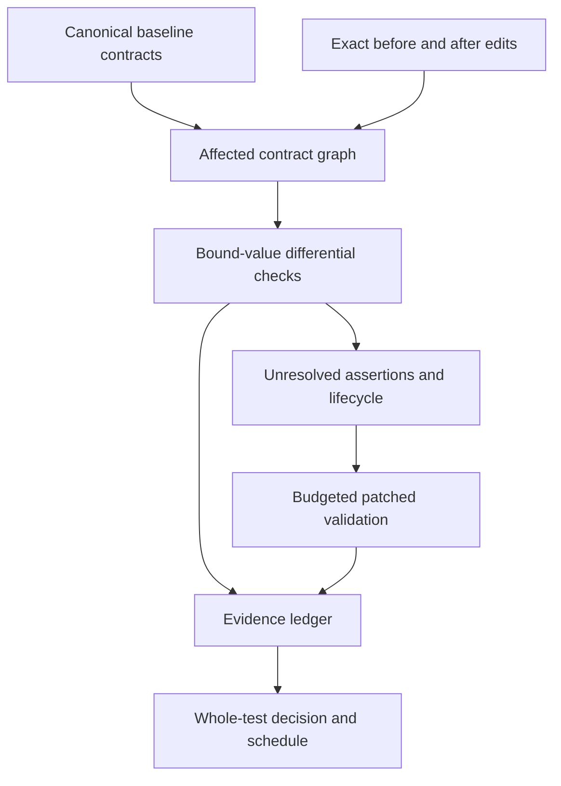

# Current proposal revision

The implemented next run uses baseline operand observations and source metadata
dependencies. [OBSERVATIONS.md](OBSERVATIONS.md) contains its theory, measurements,
limitations and rejected approaches. Earlier proposal material follows as history.

> **Implementation result:** `rwx_next/IMPLEMENTATION.md` records the new pipeline and source-evidence repair. The official local sample scorer reports **250.453 simulated seconds / zero misses** using the mixed local profile plus source-derived IPC closure. Canonical validation, fine-grained state reconstruction and pass-omission promotion remain pending.

# RWX proposal: input-conditioned incremental validation

**Revision:** 21 November 2026. **Status:** initial implementation now exists in `rwx_next/`: exact change/fixture IR, bound-value checks, optimizer context capture, isolated original-test execution, evidence ledger and cost controller. See [IMPLEMENTATION.md](rwx_next/IMPLEMENTATION.md). Passing-result omission is not promoted; fine-grained stateful replay and canonical validation remain incomplete. No improved competition score or leaderboard result is claimed.

**Decision:** replace the rowwise “patch features + test features → failure probability” foundation. Build an executable model of test inputs, state, dependencies and assertions. Use exact change semantics and narrowly scoped differential evaluation to determine which assertions need validation. Learning supports prioritization and uncertainty; it does not invent missing execution evidence.

The purpose is reliable incremental regression validation for RWX: explain which behavior changed, which assertions can observe it, and what evidence supports each omission. Top three remains the competitive goal. Under 100 seconds remains a measured-result target, not an architecture promise.

## 1. What the problem actually demands

The [official statement](https://www.joinbuilders.org/buildathon/tracks/blast-radius) and the downloaded SCORING.md in the [official kit](blast-radius-sample.tar.gz) were reread for this revision. Every patch independently targets SQLGlot `eb11aec4be8cb2122afe713a4816662c3f0fb2fa`.

We must include **every failing whole test**, including tests with a failing subtest, import error, error or timeout. Finding one representative failure is insufficient. A missed patch adds 300 seconds. The chosen tests incur their busiest worker's recorded duration plus two seconds per occupied worker; all selector/child CPU is also charged. Running patched tests during selection is explicitly allowed. Runtime is offline, with two cores, 4 GB RAM and a 180-second batch limit; the final has roughly 1.5 times as many cases and 270 seconds. The root filesystem is read-only and temporary storage is limited to 64 MB.

Pinned-source coverage/import/fixture maps are permitted. Prepared patch- or edit-kind-to-failure lookups are forbidden. The final includes new change kinds. Our new persistent evidence must describe the baseline program and real test contracts, never precomputed mutation answers. Test-capsule/checkpoint caches need their derivation and semantics documented; the statement explicitly allows actual test execution, but does not explicitly endorse every proposed replay optimization.

## 2. Why the old foundation fails

The reproducible numbers are in [core_audit.json](rwx_next/reports/core_audit.json). These are diagnostics on the already inspected 30 public patches, not unseen validation.

| Core gap | Evidence | Consequence | Required repair |
|---|---|---|---|
| Missing evidence is concentrated in important behavior | 52 of 73 public failing patch–test pairs are in the 228-test untrusted region; 48 of 73 are optimizer failures | Most failure evidence is missing where it matters; extra dialect statistics do not repair it | Complete canonical optimizer, fixture and executor provenance first |
| A global fallback fixes an expensive critical path | Every patch includes the 21.454-second TPC-DS executor test | A certified 703.620-second public-sample floor before CPU | Resolve that test's actual dependency/observation boundaries; do not simply remove it |
| Counts discard discriminating values | 69 predictors have 14 identical-vector groups with contradictory outcomes; 203 still have five | A deterministic rowwise classifier cannot separate these rows regardless of size | Preserve exact before/after values and actual bound test inputs/state |
| Coverage conflates reachability and failure | The 945.339-second zero-miss policy has only two per-patch costs: 27.454 or 36.817 seconds | Smaller relevance lists often leave the same expensive test/worker cost | Evaluate propagation to assertions and measure marginal schedule savings |
| The training sample is tiny and correlated | 48,600 rows represent only 30 changes and 73 positives | Apparent row count overstates independent evidence; new-family performance collapses | Model baseline input/behavior distributions; do not rely on public failure-label generalization |
| Ranking and complete-set decisions are different tasks | Rich MLP: 785.491 seconds of selected work plus 600 of penalties in grouped CV; 611.310 plus 1,800 in family CV | Even eliminating misses leaves far too much work | Evaluate complete failure sets, harmless cases and selected-work cost separately |
| Easy replay does not cover the hard region | 466 simple dialect tests contain zero public positive pairs; patched pilot executions cost 19.122 child CPU seconds | Fast examples can distract from the actual bottleneck | Start with optimizer fixtures, executor state and stress-test contracts |

### 2.1 A concrete information-loss failure

Consider an edit `x > 10` → `x > 11`. A test input of 10 preserves the old result, while 11 changes it. Counts of numeric constants, AST nodes and comparison operators do not preserve this distinction. Absolute numeric deltas also discard edit direction. SQL AST histograms similarly discard which value is bound to which clause, option, schema or expected exception.

The measured feature collisions are stronger evidence than this illustration: the existing real public matrices contain the same predictor vector for both passing and failing cases. They do not prove that all bad scores are caused by collisions. The fallback and missing causal evidence are larger problems.

### 2.2 A useful lower-bound check

Using public labels **offline only**, require every feature-equivalence class containing a failure to be selected. For deterministic classifiers whose binary decision depends only on that row's numeric vector, the minimum zero-miss scheduling cost is **102.655 seconds with 69 predictors**, before CPU. For 203 predictors it is **95.920 seconds**. A valid scheduling lower bound and a feasible schedule coincide for both calculations.

This bound does not apply to an architecture with new inputs, joint context, duration-dependent decision rules or live evidence. It demonstrates that the old 69-feature rowwise formulation cannot reach public-sample sub-100 with complete recall even with an oracle feature classifier. The rich representation removes part of that barrier but leaves very little margin and no learned-model reliability evidence.

## 3. New base: executable assertion contexts

The modeling unit becomes a **contract invocation in its actual state**, linked to a whole numbered test. One test can own many invocations and lifecycle obligations. The representation is a typed dependency graph plus exact values, not a fixed bag of statistics.



### 3.1 Baseline evidence plane

Generate evidence from the exact organizer image and lock, with integration enabled. Require every numbered test to have an accounted baseline outcome and dependency status. A passing baseline test alone does not prove complete tracing. Record Python/process/native boundaries and shared setup, teardown, imports and collection separately.

Prioritize the currently untrusted optimizer/executor region and the expensive tests: TPC-DS execution, TPC-H execution, optimized TPC-H, parser max-nodes and generator memory. This priority follows measured gaps; **it must not become a runtime list of sample-specific answers**. Runtime uses source-derived graph relations for every catalog test.

Record:

- Whole-test identity, source/assertion locations, subtest ownership and expected assertion/exception semantics.
- Exact SQL/fixture records, dialect bindings, optimizer pass order, schema, options, metadata and expected outputs. Preserve record order and shared state.
- Function entry, relevant branches and values, module/class initialization, global and registry reads/writes, dispatch and fixture consumers.
- Setup caches, external/native engine state, worker/process attribution and source/raw-byte observers.
- Evidence completeness, source/helper/loader hashes and the environment fingerprint.

Keep a compact broad dependency map for the suite. Collect richer value/state evidence first for expensive and unresolved regions. Full event traces can exceed the 20 MB repository/build-time budgets; use exact compressed records or reproducible build-time artifacts. A probabilistic sketch or truncated trace can prioritize work but cannot certify non-impact.

### 3.2 Change representation

Produce an ordered semantic edit IR that retains AST location and binding, old/new expression, signed literal changes, operator order, function signature/default changes, imports, registry writes and raw fixture-byte changes. Resolve both old and new dependencies. Multi-file effects are analyzed together.

Classify edits by what must be validated, rather than a learned edit-kind-to-failure association. Body-only changes, initialization changes, fixture-reader changes, source-observer changes and unsupported native/dynamic behavior need different evidence scopes. An AST-identical or comment-only patch is not automatically harmless.

### 3.3 Contract graph

Use explicit edges for `calls`, `binds argument`, `reads/writes state`, `dispatches through`, `loads fixture`, `asserts value`, `expects exception`, `initializes` and `owns subtest`.

For optimizer fixtures, an invocation must bind **query + schema + dialect + rule sequence + expected assertion**, not just “contains SELECT and JOIN.” For executor tests, it must include **table rows/types + connection/setup + generated plan/query + result comparison + process ownership**. Memory and limit tests retain allocation/GC/exception/reset behavior; SQL output alone cannot represent them.

Baseline reachability retrieves candidates. Complete old-trace non-reachability can support non-impact only under a restricted deterministic, closed execution contract, with unchanged initialization/state and no untracked observers. New dispatch, missing reads, subprocess gaps or changed setup invalidate that argument and widen the graph. An incomplete trace never supports a negative claim.

## 4. Differential validation instead of generic failure prediction

For an affected contract, ask: **does this exact edit change any value, control decision or side effect that its real assertion can observe?**

Use the following sequence, with explicit evidence boundaries:

1. **Exact bound-value checks.** For supported side-effect-free primitive expressions, compare old/new semantics on the complete observed input domain for that invocation. Preserve exact values, types, short-circuit and exception behavior. Arbitrary calls, overloaded operators, mutable aliases or unobserved domains return unknown.
2. **Propagation boundary checks.** If an affected computation can be replayed with a validated state reconstruction, compare every relevant output and side effect. Equal return values alone do not prove equivalence. A changed branch, new call or unmodeled state invalidates downstream baseline reuse.
3. **Original assertions.** Execute the original helper/case assertion in the patched environment when a validated replay contract exists. For a fixture change, use the **new** loader output and new expectations, not cached old expectations.
4. **Whole-test execution.** Use the canonical original test for unsupported isolation, stateful behavior or lifecycle changes when affordable. Otherwise retain that test as unresolved in the emitted selection.

An expression-equivalence result is a local result, not permission to mark its whole test passing. All affected observations and lifecycle obligations still need accounting. A known failing invocation is enough to retain its entire numbered test and stop checking its other invocations for selection purposes. It does not justify ignoring other numbered tests.

### 4.1 Test-family adapters

| Family | Baseline contract | Runtime validation | Mandatory fallback |
|---|---|---|---|
| Optimizer fixture cases | Actual loader records, metadata, schemas, rule sequence, expected SQL/tree and helper fingerprint | Re-evaluate affected records and their original assertions; preserve cross-record state | Missing fixtures, changed loader/helper semantics, unresolved record interactions |
| Executor cases | Input tables, connection/setup, query/rule pipeline, reference-result semantics, child-process context | Replay the changed query/plan only if complete engine/state reconstruction is validated | Native state, connection mutation, process errors or data serialization ambiguity |
| Dialect/parser contracts | Exact arguments, dialect/options, input SQL, expected exception/output, subtest context | Original assertions or guarded expression evaluation | Helper return values used by later assertions, extra setup or unsupported generated inputs |
| Stress/memory/limits | Loop bounds, allocation/GC observations, exception/reset sequence, complete dependency closure | Prefer supported non-impact proofs; otherwise retain/run original test | Never replace a stress input with a small example and claim its resource behavior passed |
| Imports/classes/registries/source observers | Collection and lifecycle reads, dispatch and initialization dependencies | Fresh patched import/lifecycle checks plus widened consumers | Unknown dynamic/native/source observers remain unresolved |

This is a restricted incremental validator, not a sound analyzer for arbitrary Python. Each adapter needs its own equivalence checks against the canonical runner before it can justify omissions.

## 5. What the model should learn

We still use signals, but the target changes from a tiny-table failure posterior to **input-conditioned behavior and uncertainty**.

Useful baseline targets are distributions of argument values/shapes, schemas, dialect/rule combinations, branch outcomes, state-access patterns and assertion-observable boundaries, conditional on test capability and call context. Preserve exact records alongside learned summaries. Baseline learning cannot determine all outcomes of a changed program; runtime differential evidence supplies the missing counterfactual where supported.

Start with a typed graph and exact indexes. Add a small retrieval/prioritization model only if it improves a fixed evidence budget. A contextual encoder can consume exact edit structure, bound input/state and graph paths. Its outputs should rank which unresolved contract to inspect next, identify unsupported regions and predict verification cost. It must not silently drop a test because its predicted failure probability is low.

Do not return to a GNN/transformer comparison until graph completeness and actual input bindings exist. More architecture capacity cannot recover information thrown away upstream. If future outcome-trained weights are considered, their provenance, eligibility and independent validation remain separate requirements; none are part of this redesign's submission.

## 6. Decision plane and CPU economics

Each numbered test receives an evidence ledger:

| State | Required evidence | Output action |
|---|---|---|
| `confirmed_fail` | A faithful patched assertion/lifecycle failure | Include whole test |
| `validated_pass` | All relevant assertions/lifecycle covered by validated replay or canonical execution | Omit only within the validated execution scope |
| `supported_nonimpact` | Complete dependency/semantic argument with explicit assumptions | Omit |
| `unresolved` | Any missing, unsupported, invalid or timed-out analysis evidence | Include unless further validation resolves it |

A verifier timeout is not automatically an official test timeout; it produces unresolved evidence. Actual canonical test timeouts/errors are failing outcomes. Native crashes and incomplete child attribution cannot be converted to pass.

Only output an empty selection when **every test** has supported pass/non-impact evidence. Do not multiply marginal probabilities or use a learned harmlessness shortcut.

The controller operates on marginal scheduled savings. For selected set S and verification action a, estimate `C(S) - E[C(S after a)] - CPU(a)`, using recorded durations and measured user+system CPU. Learned estimates choose actions, never establish pass evidence. If the action is unlikely to save its own CPU or cannot finish inside the batch budget, keep the unresolved tests and stop. Removing tiny tests while a 21-second critical-path test remains generally has little value.

Cold isolated patched execution is the correctness reference. Avoid a cold interpreter per tiny test. A clean supervisor can eventually amortize standard-library startup through isolated forks, but SQLGlot initialization/state must be correct for each independent patch. Live function hot-swapping, stale imports, cached defaults, descriptors and aliased function references are not approved shortcuts. Optimize isolation only after equivalence testing.

Keep the existing 1–8-worker scheduler and JSON protocol adapter. Failure evidence and duration-based scheduling remain separate.

## 7. Feasibility work performed for this revision

[audit.py](rwx_next/audit.py) reproduces the cost decomposition, failure-location counts and feature-class bounds. It reads public answers **offline only** and is excluded from submission artifacts.

[replay_smoke.py](rwx_next/replay_smoke.py) does not read answers. It reconstructs hash-verified pinned Python source, identifies 466 methods consisting of literal `validate_identity`/`validate_all` calls, and executes their **original whole unittest methods and helpers**. Every patch uses a fresh Python 3.13 interpreter. This is not a capsule compiler and not canonical pytest.

Measured results:

- Baseline: 466 tests, no failures/errors/skips in this restricted runner; 3.176 child CPU seconds.
- Patched runs: 1,316 test executions across 12 patches; 19.122 child CPU seconds. Eleven patches are unsupported by the reconstructed fixture/structural-edit scope; seven have no eligible candidates.
- Offline comparison: the eligible subset contains **zero public failing pairs**. Therefore this experiment supplies **no failure-recall evidence**.
- It covers none of the five expensive test examples listed above. The baseline fixture inventory is incomplete, and runner semantics/environment differ from the official container.

**Conclusion:** reject simple literal-SQL replay as the primary architecture. It demonstrates that invoking original assertions is feasible, and that doing so indiscriminately is the wrong use of the CPU budget. It does not validate the proposed differential engine or a competitive selector.

## 8. Implementation order and stop conditions

| Stage | Concrete deliverable | Gate before proceeding |
|---|---|---|
| 1. Canonical evidence repair | Full catalog outcome inventory and dependency status, optimizer fixture data/metadata, executor setup/child/native boundaries | No silently unaccounted numbered test; missing evidence explicitly localized. Remove the current global fallback only when evidence supports it |
| 2. Fixture/optimizer vertical slice | Bound records → actual pipeline → original assertions, independent patched source overlay, full-vs-incremental comparison | Match canonical whole-test outcomes including subtests, helper/loader edits and multi-file effects; no partial execution labeled pass |
| 3. Critical-path contract analysis | Trace/observer contracts for executor TPC-DS/TPC-H and parser/generator resource tests | Demonstrated supported exclusions or affordable validation; document which tail tests still dominate |
| 4. Differential engine | Restricted exact expression checks and validated replay boundaries with invalidation | Novel inputs/edits, exceptions, state aliasing, new dispatch and unknown paths fail closed; no stale baseline reuse |
| 5. Cost controller | Per-action user+system CPU, marginal schedule savings, batch deadline and temporary-storage accounting | Combined simulated cost + all runtime CPU improves on the guarded baseline with complete observed failure sets |
| 6. Frozen evaluation/export | Canonical image, fresh independently generated mechanism tests, budget stress, three-run median, clean allowlisted repository | No answer-derived maps/weights, valid stdout and limits; report actual held-out/official result before a speed claim |

Public examples have already influenced our thinking; new random splits do not make them untouched evidence. New mechanism tests must be chosen independently of a known sample failure list, with generator-family/source-region separation. Synthetic success still does not establish final-set recall. Include runtime environment drift, renamed IDs, changed durations, fixture metadata/raw-byte observers, import failures, subprocess errors, new control flow, multiple failing tests and resource behavior.

If stage 1 remains blocked, do not spend another round tuning neural networks. If stage 3 leaves the same critical-path floor, the redesign has not solved the score problem. If exact supported checks cannot reduce the work cheaply enough, retain the correctness-preserving result and revise the performance target. No further unsupported sub-100 forecast.

## 9. Risks and fixes

| Risk | Fix / refusal boundary |
|---|---|
| Baseline traces miss a new path | Invalidate at first changed control/state/dispatch dependency; use old+new closure; unresolved when new behavior cannot be replayed |
| A replay passes while the original test fails | Preserve real assertion semantics and all remaining obligations; validate each adapter against canonical whole-test execution |
| Fixtures encode setup/metadata as well as SQL | Track raw bytes, reader semantics, metadata and ordering; rebind new expected values; changed reader invalidates the adapter |
| Executor setup or native state is omitted | Capture/reconstruct the supported engine contract, including table/reference-result provenance; retain whole-test fallback for unsupported behavior |
| Resource tests are “proved” by small examples | Keep resource observation/exception/reset semantics; only a supported dependency/non-impact argument or original execution can resolve them |
| Trace size/build time/CPU exceeds limits | Tier broad maps and exact rich contexts; measure 10-minute build, 20 MB repository, 64 MB temporary space and whole-batch CPU; sketches remain prioritization-only |
| Novel edit gets unjustified confidence | Separate evidence completeness from learned confidence; unknown remains visible and included |
| Public outcomes leak into deployment | Quarantine diagnostic reports and answer readers; build baseline maps from pinned source; audit export contents and derivation |

## 10. Dead ends

1. **Partial coverage + global safety union:** 945.339 public simulated seconds, zero misses, but 703.620 seconds is structurally unavoidable with its always-selected uncertain set. Preserve as a reference, not the new design.
2. **69-feature model swapping:** lossy row representation, tiny independent sample and weak family transfer. Its zero-miss feature-class oracle already needs 102.655 seconds before CPU.
3. **203-feature classifier expansion:** some ranking improves, but contradictory vectors, high selected-work cost and missed complete failure sets persist. No model promoted. Full earlier plan is archived in [proposal_before_assertion_redesign.md](archive/proposal_before_assertion_redesign.md).
4. **Generic harmlessness head / threshold adjustment:** a favorable public split cannot certify that every failing whole test is included. Removing penalties algebraically still leaves several hundred seconds of work.
5. **Literal dialect replay as the main solution:** 466 eligible tests, zero public positives, and 19.122 patched-run CPU seconds. Wrong coverage priority and inadequate economics; keep only as a feasibility control.
6. **Unmeasured sub-100 promises and hot-swap shortcuts:** neither a proposed design nor small-example success is an achieved score. New promotion gates require combined cost, semantics and canonical runtime evidence.

## 11. What we can promise

We can commit to preserving exact edit/input information, exposing missing evidence, accounting for whole tests and lifecycle, and charging every validation action to its real CPU budget. The learned component will have a defined purpose and an explicit inability to establish safety by confidence alone.

We cannot promise immunity to unseen tests, complete correctness for arbitrary Python, top three or sub-100 before measurement. On the current public sample, the **exact failure-set scheduling optimum is 94.351 seconds**; only **5.649 seconds** remain for all selector CPU and excess selections. That is a demanding engineering budget, not a general ceiling for a different private batch.

## Reproduce the current diagnostics

Unpack `blast-radius-sample.tar.gz` into `rwx/sample/` if the expanded kit is absent. From the parent directory of `fourthon/`:

```bash
python fourthon/rwx_next/audit.py
python fourthon/rwx_next/replay_smoke.py --python /path/to/python3.13
python fourthon/rwx_next/summarize_replay.py
```

These scripts are research artifacts. Existing frozen submission exports remain unchanged. No API key is required. The exact organizer Docker environment is still required for canonical profiling and replay equivalence; it was unavailable for this revision's local experiments.
